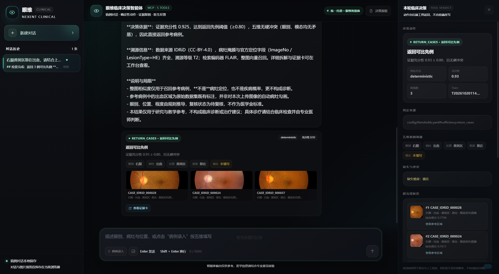
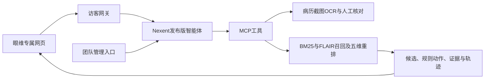

# 眼维 · Yanwei

**面向眼科教学与临床科研的多模态病例检索与证据复核原型。**

最新团队开发版：2026-10-20。团队部署并配置一套眼维，用户通过专属网页导入病历截图、上传眼底图或输入描述。Nexent实际调用MCP完成处理，普通用户不需要配置模型或智能体。

当前提供可复现源码与部署配置，没有已上线的公网演示地址。研究原型尚无独立医学有效性验证，相似度不是疾病概率。



截图来自已有本机环境，已准备原图、模型、索引与Nexent授权；克隆仓库本身不会取得这些资源或授权。

## 最新链路



已有六个工具：实体解析、病例检索、医学逻辑规则核对、证据生成、反馈记录、病历截图读取。OCR确认前不执行该次病例检索。后端结果与本轮请求关联，前端不根据模型文字伪造候选。

## 组员从这里开始

1. 克隆仓库，阅读[协作指南](CONTRIBUTING.md)。
2. 选择文字工程基线，或准备资源后运行完整Docker环境。
3. 在自己的任务分支迭代，提交PR并附实际检查结果。

| 文档 | 内容 |
|---|---|
| [资源准备](docs/setup.md) | 模型、原图、索引；源码与完整部署包的差异 |
| [团队部署与维护](团队部署与维护.md) | Docker、本机管理、访客入口、网络与首次配置 |
| [用户使用说明](用户使用说明.md) | 病历核对、图片查询、参考病例与反馈 |
| [三人分工与AI协作](docs/眼维_三人团队分工与AI协作执行方案_20261020.md) | 责任、工具协助、首轮任务与验收 |
| [研究与算法路线](docs/眼维_研究定位与技术算法优化实施方案_20261020.md) | 赛题差距、复现、数据评测、图谱及界面计划 |
| [工程验收报告](统一托管与病历导入验收报告_20261020.md) | 已验证流程、计时和限制，不能替代医学评测 |

## 运行方式一：轻量文字基线

安装Python 3.11/3.12，在仓库根目录运行：

```bash
python -m pip install -r requirements-demo.txt
python 02_代码/run_demo.py --port 8765
```

打开 `http://localhost:8765/chat`。这是直接调用本地后端的工程调试入口，**不是完整Nexent用户产品链路**。没有原图或模型时会明确降级，不提供虚假图片或向量结果。

## 运行方式二：完整Nexent网页应用

先按[资源准备](docs/setup.md)放置模型、原图和索引，再安装并启动Docker（x64 Linux容器）。首次启动需要联网构建、下载基础镜像。

- Windows：双击 `START.cmd`。
- Linux：仓库根目录执行 `sh start.sh`。
- 团队管理入口：`http://localhost:18880/hosting-admin`。
- 访客网页：`http://localhost:18881/console`。

首次由团队管理员登录Nexent、配置模型服务、初始化并发布智能体、启用访客服务。当前机器的密钥和平台数据库不在仓库里；代码内的bootstrap负责在新环境绑定当地ID，不能直接照搬旧ID。

基础部署16个服务，建议24GB内存、至少25GB空余磁盘；实际需求取决于Docker分配和资源准备。本机、同网和公网访问不同；localhost仅指当前电脑。可选HTTPS配置见团队文档，尚未声称已在全新服务器公网验收。

## 工程检查

```bash
cd 02_代码
python -m unittest discover -s tests -p "test_*.py"
python tests/run_golden.py
cd ../integration
python -m unittest test_integration test_public test_hosting
```

仓库新增GitHub Actions工程检查。CI及fixture测试不代表真实模型、Nexent外部服务或临床有效性通过；当前复测结果见[验证记录](docs/validation/README.md)。

## 已有功能与尚未完成

- 已有：文字/图文召回、冲突追问、截图OCR核对、候选与证据、访客隔离及限流、团队统一授权。
- 检索已包含基于排名的BM25/语义融合；RRF是公开方法，不是本项目原创。
- 当前索引对应81张图；有待复核派生字段及合成/弱配对，查询标注DEMO_ONLY。
- 尚未完整验收：半自动本体持续更新、跨文档多跳推理、可复用Skills与反馈更新闭环。
- 暂不支持直接导入PDF/Word/Excel、多页合并；截图导入作为查询不等于拥有可持续检索的个人病例库。
- 无正式用户账户、跨设备历史或自动文件清理；没有全新宿主机完整冷启动和临床准确性结论。

模型权重、原始图片、索引、上传病历、会话数据库、密钥与浏览器资料不会进入Git。第三方许可保留于NOTICE.md及相应vendor目录。本项目自有代码目前未另行授予开源许可；入围比赛的正式开源要求仍需由团队落实。
