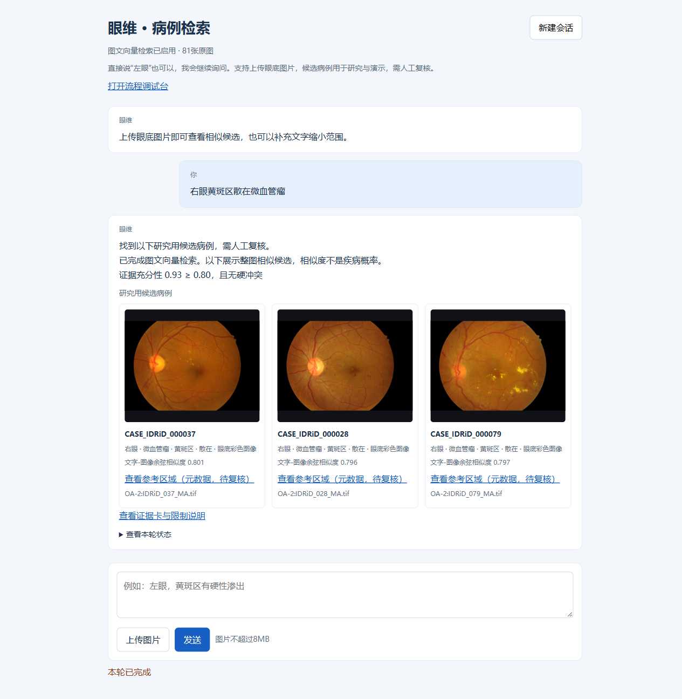
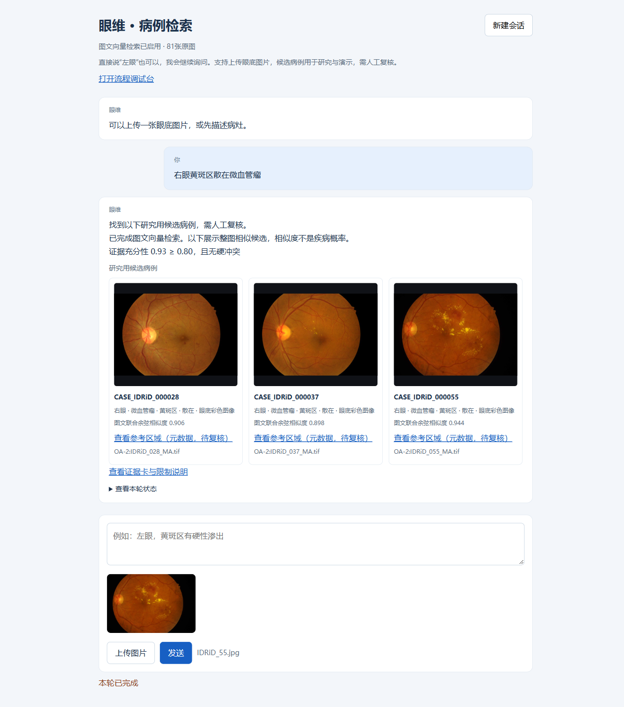
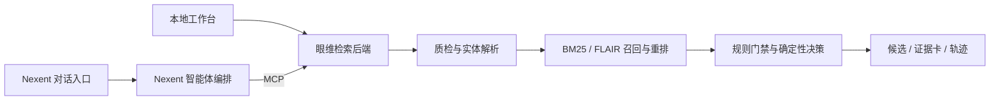

# 眼维 · Yanwei

**面向眼底影像的图文相似病例检索与证据复核智能体原型**

Python · BM25 · FLAIR · MCP · Nexent · 可追溯规则决策

眼维将眼底图片和中文病灶描述作为查询，检索可比较的参考病例，并通过结构化规则决定返回候选、追问、拒答或给出规则性转诊提示。结果保留病例来源、模型/规则版本和执行轨迹，便于人工复核。

本项目面向科研与教学演示，尚未完成独立医学有效性验证；候选相似度不代表疾病概率。没有比赛获奖或临床部署声明。

## 演示



*现有演示环境的真实文字检索结果；该环境已准备公开原图和模型。轻量源码仓库不包含这些大文件。*



*真实上传 IDRiD 公开图片后进行图文召回；图中的区域属于参考病例既有元数据，不是本次上传图的自动病灶定位。*

## 项目重点

| 模块 | 实现 |
|---|---|
| 图文检索 | BM25 保留中文词面，FLAIR 编码整图与已识别术语的英文映射，使用 RRF 融合召回及结构化一致性重排 |
| 确定性决策 | 眼别、病灶、位置、程度、模态五维画像；规则与阈值外置，决策不依赖大模型临时发挥 |
| 输入冲突门禁 | 左右眼并存先澄清，支持明确否定和改口；追问后选择单眼时保留病灶与位置 |
| 智能体工具 | 5 个 MCP 工具，可接入 Nexent；支持一次完整工作流调用，减少模型拼接中间状态 |
| 可复核输出 | 证据卡、来源、版本指纹与轨迹；完整 HTML 保留在后端，通过 ID/链接返回 |
| 工程可靠性 | 参数校验、超时后的重叠重试限制、澄清轮次上限、幂等反馈和功能回归 |

## 两种运行方式



**本仓库的 `/chat` 页面直接调用眼维后端，可以独立演示；现有 Nexent 接入通过 MCP 调用同一套后端。** 自定义前端经 Nexent 驱动的统一产品入口仍在计划中。Nexent 的完整平台、账号配置和在线模型服务不随此仓库分发。

## 快速运行：文字基线

需要 Python 3.12。以下命令在仓库根目录执行：

```bash
python -m venv .venv
# Windows PowerShell
.venv\Scripts\Activate.ps1
# macOS / Linux: source .venv/bin/activate
python -m pip install -r requirements-demo.txt
python 02_代码/run_demo.py --port 8765
```

打开 `http://127.0.0.1:8765/chat`。`/` 为流程调试台。Windows 已有可用 Python 环境时也可运行 `启动源码Demo.cmd`。请先完整克隆/解压仓库，不要在压缩软件内直接双击脚本。

本仓库包含派生检索表，文字基线无需模型权重即可运行。未准备原图时，参考病例图片不可展示；未准备 FLAIR 权重与索引时，程序明确使用文字/规则基线，不能把降级结果当作向量检索成功。

可以依次测试：

1. “左眼” → 追问病灶和位置。
2. “黄斑区散在微血管瘤” → 保留左眼上下文并完成检索。
3. 新建会话：“左眼和右眼黄斑区散在出血” → 先确认眼别，不返回单眼候选。
4. “只查右眼” → 保留原病灶、位置，按右眼继续。

## 启用图文向量检索

见 [模型与数据准备](docs/setup.md)。这一步需要按固定修订准备 FLAIR、ClinicalBERT、IDRiD 原图，并重建离线索引。模型权重、个人上传文件、运行环境和大体积交付压缩包不会上传到仓库。

Nexent 接入方法见 [平台接入说明](docs/nexent.md)。运行边界和后续工作见 [当前状态](docs/status.md)。

## 验证

```bash
cd 02_代码
python -m unittest discover -s tests -p "test_*.py"
python tests/run_golden.py
```

截至 2026-10-18，公开源码快照本地执行 **35 项 unittest 和 4 条动作 golden 通过**。原完整图文交付包另外做过真实上传、模型加载、向量检索、证据读取和跨路径自检；这些是工程验证，不是医学准确率评测。证据摘要见 [验证记录](docs/validation/README.md)。

## 目录

```text
01_数据集/          派生检索表、演示查询与数据字典
02_代码/
  yanwei/          解析、召回、规则、证据、对话和 HTTP/MCP 服务
  config/          规则、阈值与图文设置
  web/             本地工作台和调试界面
  tests/           功能、协议、图文契约及冲突门禁回归
  tools/           权重准备、原图索引与数据检查
docs/              架构、部署、验证与演示截图
```

## 能力边界与后续工作

- 当前向量检索是整图级召回；U-Net/启发式接口不代表已验证的病灶分割或分类能力。
- 当前检索表覆盖 81 病例、282 区域；363 条图文配对属于合成/弱配对，尚无真实配对金标准。派生字段为 PENDING，演示查询为 DEMO_ONLY。
- 已有反馈存储，尚未完成“审核反馈 → 更新策略/索引 → 独立评测 → 回滚”的进化闭环。
- 本地页自然语言取消旧图、无效反馈 ID 校验和部分 Nexent 多轮耗时仍需完善；取消旧图请先新建会话。

## 来源与许可

模型复用 [FLAIR](https://github.com/jusiro/FLAIR) 与 Bio_ClinicalBERT；数据来源为 IDRiD。请保留原作者归属，不将预训练模型或公开数据描述为本项目自行训练/采集的成果。详见 [第三方来源与许可说明](NOTICE.md)。本项目代码目前未另行授予开源许可，公开可读不代表放弃作者权利。
